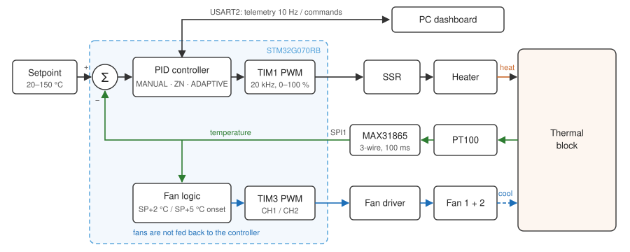
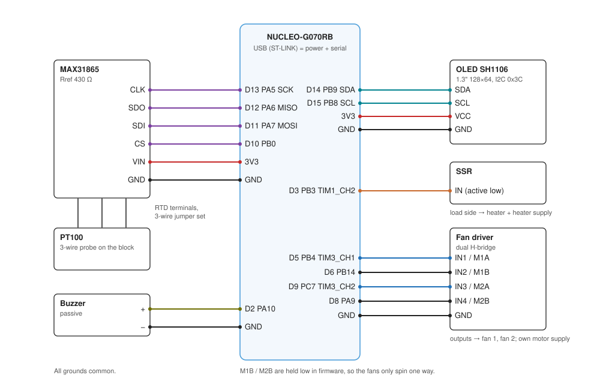
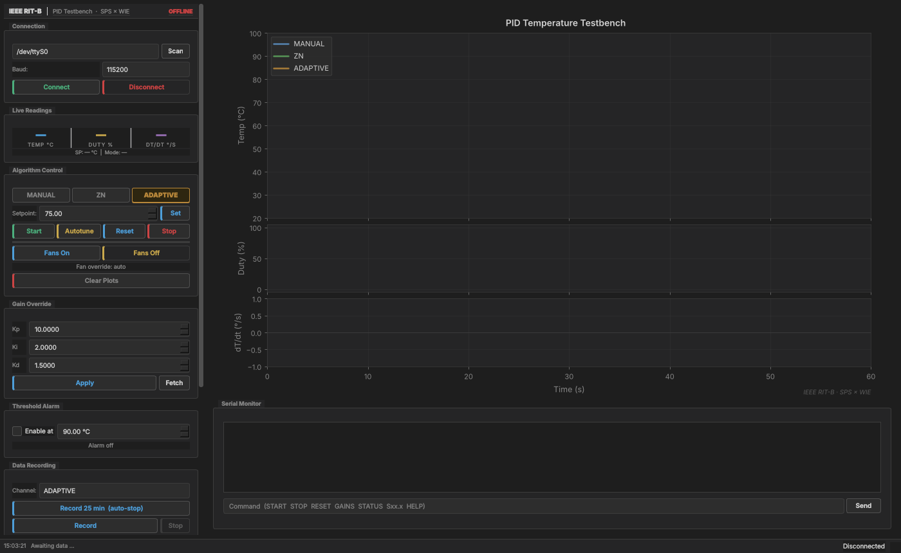

# PID Temperature Testbench

IEEE SPS × WIE testbench for the paper *"Comparative Analysis of PI Tuning
Techniques for Embedded Thermal Control Systems"*.

A PT100 on a heated block is held at a setpoint by one of three controllers
running on a NUCLEO-G070RB. The bench logs step-response metrics on the board
and streams telemetry to a desktop dashboard, so the three controllers can be
compared on the same hardware.



```
firmware/    STM32CubeMX / HAL project (C), pid_testbench.ioc
dashboard/   PyQt5 + Matplotlib live plotter and CSV recorder
docs/images/ diagrams and screenshots
```

## Hardware



| Function            | Nucleo pin | MCU pin | Peripheral          | Notes                               |
|---------------------|-----------:|--------:|---------------------|-------------------------------------|
| SSR (heater)        | D3         | PB3     | TIM1_CH2, 20 kHz    | active low, internal pull-up        |
| Fan 1 speed (M1A)   | D5         | PB4     | TIM3_CH1, 20 kHz    |                                     |
| Fan 1 M1B           | D6         | PB14    | GPIO                | held low, one direction only        |
| Fan 2 speed (M2A)   | D9         | PC7     | TIM3_CH2, 20 kHz    | driven ×1.2 in software             |
| Fan 2 M2B           | D8         | PA9     | GPIO                | held low                            |
| Buzzer (passive)    | D2         | PA10    | GPIO, toggled by TIM6 |                                   |
| MAX31865 CS         | D10        | PB0     | GPIO                |                                     |
| MAX31865 MOSI       | D11        | PA7     | SPI1                | mode 1, 2 MHz                       |
| MAX31865 MISO       | D12        | PA6     | SPI1                |                                     |
| MAX31865 SCK        | D13        | PA5     | SPI1                | shares the on-board LED (LD4)       |
| OLED SDA (SH1106)   | D14        | PB9     | I2C1, 400 kHz       | 128×64, address 0x3C                |
| OLED SCL            | D15        | PB8     | I2C1                |                                     |
| Serial console      | USB        | PA2/PA3 | USART2 via ST-LINK  | 115200 8N1                          |

- **Sensor:** PT100, 3-wire, into a MAX31865 with Rref = 430 Ω. Set the
  board's 2/3-wire solder jumper for 3-wire.
- **Grounds:** the Nucleo, the MAX31865, the fan driver and the SSR input
  must share ground. A missing common ground is the usual reason a fan
  won't spin.
- **SSR:** 20 kHz PWM suits a DC SSR or a MOSFET module. A zero-cross AC
  SSR can't follow it; use a slow time-proportioning drive for that.

Still to be filled in for this build: heater type and voltage, SSR model, fan
driver module and fan supply voltage.

## Firmware

### Building

**STM32CubeIDE:** *File → New → STM32 Project from an Existing STM32CubeMX
Configuration File*, pick `firmware/pid_testbench.ioc`, then build. Or open
the `.ioc` in STM32CubeMX and press *Generate Code* (toolchain: STM32CubeIDE).
Everything custom sits in its own files or between `USER CODE` markers, so
regenerating is safe.

**Command line:** needs `arm-none-eabi-gcc`.

```
cd firmware
make            # build/pid_testbench.elf, .bin, .hex
make flash      # needs STM32_Programmer_CLI
```

The linker script keeps the last 2 KB flash page out of the program area for
settings. If CubeIDE ever recreates `STM32G070RBTX_FLASH.ld`, set FLASH back
to 126K.

### Source layout (`firmware/Core/Src`)

| File            | Does                                                           |
|-----------------|----------------------------------------------------------------|
| `app.c`         | State machine, safety checks, telemetry, command handlers      |
| `controller.c`  | Shared PID core and the three modes                            |
| `autotune.c`    | Relay autotune and the Ziegler–Nichols rules                   |
| `metrics.c`     | Step-response metrics                                          |
| `max31865.c`    | Non-blocking RTD driver (bias → one-shot → read every 100 ms)  |
| `outputs.c`     | Heater PWM, fan logic and ramping, buzzer melodies             |
| `sh1106.c`      | OLED driver and 5×7 font; sends one page per loop pass         |
| `display.c`     | OLED pages                                                     |
| `console.c`     | Interrupt-driven UART with ring buffers                        |
| `commands.c`    | Serial command parser                                          |
| `storage.c`     | Settings in flash with CRC and wear levelling                  |
| `app_config.h`  | Every tunable number in one place                              |

The rest (`main.c`, `tim.c`, `spi.c`, …) is CubeMX initialisation code.

### Controllers

All three share one PID core: derivative on measurement (no kick on setpoint
steps) with a low-pass filter, an integrator that only runs near or above the
setpoint and unwinds three times faster above it, and anti-windup at full
output. The fans never feed into the controller.

| `MODE` | Name     | Gains                                                                                   |
|-------:|----------|-----------------------------------------------------------------------------------------|
| 0      | MANUAL   | Kp 10, Ki 2, Kd 1.5. Baseline. `SETGAINS` overrides it until reboot.                    |
| 1      | ZN       | From relay autotune. Default rule is ZN "no overshoot" (0.2 Ku, Ti = Tu/2, Td = Tu/3).  |
| 2      | ADAPTIVE | Gain schedule on \|error\|: > 15 °C Kp 20 / Ki 1, 5–15 °C Kp 12 / Ki 2, < 5 °C Kp 6 / Ki 3.5, Kd 1.5, with 0.5 °C hysteresis between zones. |

`ZN_RULE` in `app_config.h` switches between classic PID, no-overshoot PID
and classic PI.

**Autotune:** the heater toggles 0/100 % around the setpoint with 0.3 °C
hysteresis. The first two switches (the heat-up) are ignored; switches 3–6
give the amplitude and period, then Ku = 4d / (π√(a² − h²)). The result and
the measured hold power are saved, and control hands over to ZN with the
integrator preloaded, so there's no bump. The test gives up after 45 minutes,
or if the oscillation is too small to trust; the old gains are kept.

### Safety

- Boots idle. Nothing heats until `START` (or `AUTOTUNE`).
- **Sensor fault:** any bad sample turns the heater off for that cycle; five in
  a row (0.5 s) latch a fault. Bad samples include a MAX31865 fault bit, a
  chip that stops answering, a reading outside −40…400 °C, or a jump of more
  than 15 °C between samples.
- **Over-temperature:** 160 °C latches a fault regardless of setpoint. It
  clears below 150 °C.
- **No heat rise:** heater above 80 % for 3 minutes while more than 10 °C under
  SP, with less than 1.5 °C of rise, latches a fault (heater unplugged, or the
  sensor off the block).
- In a fault the heater is locked off and both fans run flat out. `STOP`
  clears it once the cause is gone.
- 2 s hardware watchdog. A hard fault forces the SSR line high.
- Setpoint limited to 20–150 °C.

### Serial commands

115200 baud, any case, one per line.

| Command               | Action                                                         |
|-----------------------|----------------------------------------------------------------|
| `START` / `PI`        | start control in the current mode                              |
| `STOP` / `H0`         | heater off; also clears a fault once it's gone                 |
| `AUTOTUNE`            | relay autotune at the current setpoint, then ZN control        |
| `RESET`               | clear the integrator, restart the step metrics                 |
| `FANMODE [ON\|OFF]`   | both fans at 100 %, heater locked off; toggles without arg     |
| `S75` / `S72.5`       | setpoint in °C                                                 |
| `MODE 0\|1\|2`        | MANUAL / ZN / ADAPTIVE                                         |
| `SETGAINS kp ki kd`   | set the MANUAL gains (until reboot) and switch to MANUAL       |
| `GAINS`               | active gains and the stored autotune gains                     |
| `METRICS`             | step metrics for the current run                               |
| `STATUS`              | state, sensor, fans, autotune data, uptime                     |
| `V0`…`V10`            | buzzer volume (0 mutes)                                        |
| `FACTORYRESET`        | erase setpoint, volume and autotune results                    |
| `HELP`                | list commands                                                  |

Errors start with `ERR`.

### Telemetry

One line per 100 ms control cycle:

```
SP:75.0 T:23.45C D:0% M:ZN Kp:10.000 Ki:2.0000 F1:0% F2:0% dT/dt:0.00 Kd:1.500
```

`M` is `MANUAL`, `ZN` or `ADAPT` while controlling, otherwise `AUTOTUNE`,
`FANMODE`, `STOPPED` or `FAULT`. `T:nan` marks a sample the board rejected.
Kp/Ki/Kd are the gains in use; in ADAPTIVE they follow the zone.

### Step metrics

A new step starts on `START`, `RESET`, a setpoint or mode change, and after
autotune. The dashboard computes the same figures.

- **Rise:** 10 % → 90 % of the step
- **Time to SP:** first time the setpoint is reached
- **Overshoot:** peak past SP, in °C and % of the step
- **Settle:** last entry into ±2 % of the step (never tighter than ±0.2 °C),
  confirmed after 30 s in band
- **IAE:** ∫|error| dt over the step

They print with `METRICS`, and once automatically when the run settles.

### OLED

Three pages rotate every 4 s: temperature, setpoint and heater bar; the two
fans; gains and autotune progress. The frame flashes when the temperature is
more than 5 °C above SP. A fault replaces everything with a fault screen.

### Settings in flash

The setpoint (saved 10 s after the last change), buzzer volume and autotune
results (Ku, Tu, amplitude, hold power, ZN gains) are kept across resets.
Records go into the last flash page with a CRC; the page is only erased once
it fills up, and a damaged record falls back to the previous one.

## Dashboard

```
cd dashboard
pip install -r requirements.txt
python dashboard.py
```



Pick the ST-LINK port, *Connect*, choose a mode, set SP, *Start*. Each mode
has its own trace and metrics tab. *Record* writes the selected channel to CSV
(`time_s, temp_c, setpoint, duty_pct, dtdt, kp, ki, kd, mode`). *Record 25 min*
stops by itself. Earlier CSVs can be overlaid for comparison, and the plot
exports at 300 dpi.
